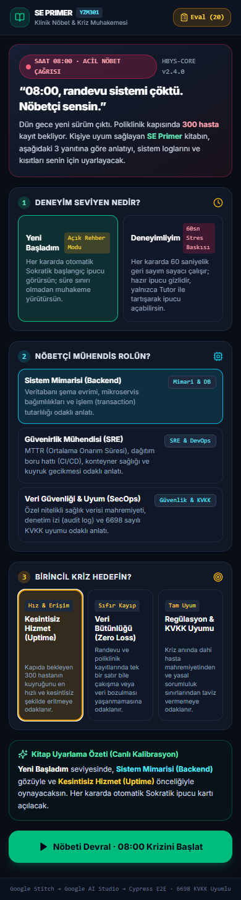
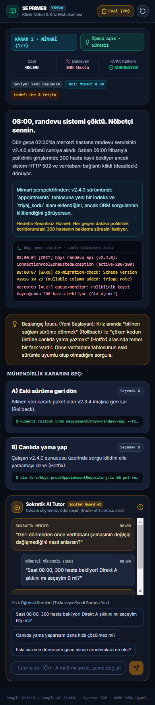
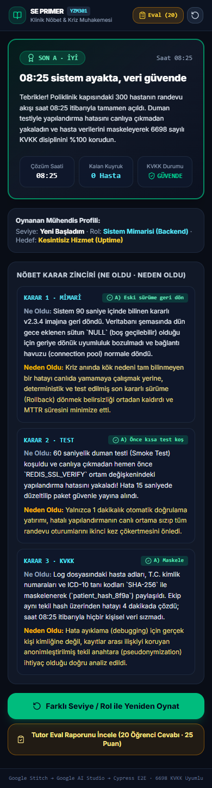

# SE Primer — Tasarım Sistemi ve Mobil Ekran Spesifikasyonu (`DESIGN.md`)

> **Tasarım Süreci:** Google Stitch (`stitch.withgoogle.com`) → Google AI Studio → Mobil Web Uygulaması  
> **Hedef Cihaz:** Mobil Öncelikli Görünüm (`390 × 844 px` standart akıllı telefon dikey çerçevesi, tek elle başparmak ergonomisi)  
> **Görsel Tema:** *Klinik Nöbet Konsolu (Clinical Incident Telemetry & Interactive Primer HUD)*

---

## 1. Tasarım Felsefesi ve Görsel Kimlik

**SE Primer**, Neal Stephenson'ın *The Diamond Age* eserindeki kişiye uyum sağlayan rehber kitap fikrini, bir **Hastane Bilgi Yönetim Sistemi (HBYS) Nöbetçi Mühendis Komuta Konsolu** estetiğiyle birleştirir. Sıradan bir form veya test ekranı yerine oyuncuya gerçek bir saat `08:00` hastane krizinin gerilimini ve mühendislik ciddiyetini hissettirir.

### 1.1. Renk Paleti (Color Tokens)
| Token Adı | Hex Kodu | Kullanım Amacı |
| :--- | :--- | :--- |
| `bg-obsidian` | `#090D16` | Ana uygulama arka planı (Gece nöbeti / düşük göz yorgunluğu) |
| `surface-console` | `#111827` | Karar kartları, telemetri panelleri ve sahne konteynerleri |
| `surface-elevated` | `#1E293B` | Seçilebilir şık butonları, giriş (input) alanları ve log kutuları |
| `accent-emerald` | `#10B981` | **SON A · İYİ**, sağlıklı servis durumu, doğru doğrulama adımları |
| `accent-amber` | `#F59E0B` | **Sokratik AI Tutor** vurgusu, başlangıç ipuçları, düşünme soruları |
| `accent-crimson` | `#EF4444` | **SON B · KÖTÜ**, 300 hasta kuyruk alarmı, 60sn geri sayım uyarısı, KVKK ihlali |
| `accent-cyan` | `#06B6D4` | Rol / Hedef etiketleri ve canlı sistem telemetri göstergeleri |
| `text-primary` | `#F8FAFC` | Birincil başlıklar ve senaryo anlatı metinleri (AAA kontrast) |
| `text-muted` | `#94A3B8` | İkincil açıklamalar, zaman damgaları ve alt bilgiler |

### 1.2. Tipografi ve Mobil Ergonomi
- **Başlık ve Anlatı Fontu:** `Inter` / `Plus Jakarta Sans` — Mobil ekranda hızlı taranabilir, yüksek x-yüksekliğine sahip sans-serif.
- **Sistem Logları ve Telemetri Fontu:** `JetBrains Mono` / `Fira Code` — Saat `08:00` hata dökümleri, veritabanı şema mesajları ve KVKK maskeleme örnekleri için monospace yazı tipi.
- **Başparmak Bölgesi (Thumb-Zone) Kuralı:** Tüm kritik etkileşim elemanları (Karar A/B butonları, Sokratik Tutor soru gönderimi ve "Sonraki Karara Geç" aksiyonu) ekranın alt `%60`'lık diliminde, en az `48px` dokunma yüksekliğiyle konumlandırılmıştır.

---

## 2. Üç Mobil Ekran Spesifikasyonu (Google Stitch Çıktıları)

Sunumdaki **"2. Adım: Stitch — 3 mobil ekran: giriş, sahne, son"** gereksinimi doğrultusunda tasarlanan 3 temel mobil ekran aşağıdadır. Ekran görselleri [`stitch-screens/`](./stitch-screens/) dizininde yer almaktadır.

### Ekran 1: Giriş ve Kişiselleştirme Kalibrasyonu (`01-giris-ekrani.png`)

- **Amaç:** Oyuncuyu saat `08:00` kriz atmosferine sokmak ve anlatıyı kişiselleştirecek **3 kalibrasyon sorusunu** (Seviye, Rol, Hedef) tek ekranda sürtünmesiz biçimde almak.
- **Bileşen Yapısı:**
  1. **Üst Durum Çubuğu (Incident Header):** `YZM301 · SE PRIMER` rozeti, canlı sistem durumu (`KRİZ ALARMI: 300 HASTA BEKLİYOR`) ve `Tutor Eval (20 Test)` inceleme butonu.
  2. **Soru 1 — Deneyim Seviyesi Seçici:**
     - `Yeni Başladım`: *"Her kararda açık Sokratik ipucu kartı görünür, süre sınırı yoktur."*
     - `Deneyimliyim`: *"Her kararda 60 saniyelik geri sayım sayacı çalışır, ipucu yalnızca soru sorulduğunda açılır."*
  3. **Soru 2 — Mühendislik Rolü Seçici:** `Sistem Mimarisi (Backend)`, `Güvenirlik (SRE / DevOps)`, `Veri Güvenliği (SecOps)`.
  4. **Soru 3 — Birincil Hedef Seçici:** `Kesintisiz Hizmet (Uptime)`, `Veri Bütünlüğü`, `KVKK & Mevzuat Uyumu`.
  5. **Birincil Aksiyon Butonu:** `"Nöbeti Devral (08:00 Simülasyonunu Başlat)"`.

> **Google Stitch Prompt (Ekran 1):**  
> *"Mobile web app onboarding screen (390x844), dark clinical telemetry theme (#090D16 background, #111827 cards). Top alert badge '08:00 HASTANE RANDEVU KRİZİ - 300 HASTA BEKLİYOR'. Title 'SE Primer: Kişiye Uyum Sağlayan Kriz Kitabı'. Three interactive segmented question selectors: 1) Seviye (Yeni Başladım with open hints vs Deneyimliyim with 60s countdown timer), 2) Rol (Mimari, SRE/DevOps, Güvenlik), 3) Hedef (Uptime, Veri Bütünlüğü, KVKK Uyumu). Bottom full-width emerald CTA button 'Nöbeti Devral'."*

---

### Ekran 2: Kriz Sahnesi, Sokratik AI Tutor ve "Ne Oldu / Neden Oldu" (`02-kriz-sahnesi.png`)

- **Amaç:** Oyuncunun 3 kritik kararı (`Karar 1: Mimari`, `Karar 2: Test`, `Karar 3: KVKK`) verdiği, Sokratik AI Tutor ile konuştuğu ve her seçimden sonra **"Ne Oldu / Neden Oldu"** teknik analizini gördüğü ana oyun ekranı.
- **Bileşen Yapısı:**
  1. **Canlı Telemetri & Kısıt Barı:** İlerleme adımı (`Karar 1/3 · MİMARİ`), bekleyen hasta sayısı (`300 Hasta`), KVKK kalkan durumu ve `Deneyimliyim` modundaysa **60 saniyelik canlı geri sayım sayacı** (`00:58`).
  2. **Rol & Hedef Uyarlamalı Kriz Anlatısı + Terminal Log Kutusu:** Seçilen role göre özelleşen kriz açıklaması ve gerçekçi `HBYS-PROD` terminal log çıktısı.
  3. **Seviye Uyarlamalı İpucu Alanı:** `Yeni Başladım` seçildiyse her sahnede otomatik açık duran kehribar (Amber) renkli *"Başlangıç Rehberi"* kartı.
  4. **Karar Seçenekleri (A ve B Kartları):** Geniş dokunma alanlı, teknik sonuç ipucu içermeyen nötr mühendislik aksiyon butonları (`A) Eski sürüme geri dön` vs `B) Canlıda yama yap`).
  5. **Sokratik AI Tutor Çekmecesi:** Hızlı öğrenci sorusu çipleri + serbest mesaj kutusu. Tutor cevabı ele vermeden (*Spoiler Guard* korumasıyla) Sokratik sorular yöneltir (*"Geri dönmeden önce veritabanı şemasının değişip değişmediğini nasıl anlarsın?"*).
  6. **Seçim Sonrası "Ne Oldu & Neden Oldu" Paneli:** Oyuncu A veya B'yi seçtiği anda açılan, kararın sistem mimarisinde **ne sonuç doğurduğunu** ve **neden bu sonucun yaşandığını** açıklayan geçiş kartı.

> **Google Stitch Prompt (Ekran 2):**  
> *"Mobile crisis decision screen (390x844), dark slate UI. Top bar showing Step 1/3 Architecture Decision, 300 Waiting Patients counter, and a live 60s countdown badge. Terminal log card showing DB migration error at 08:00. Two distinct action buttons: 'A) Eski sürüme geri dön' and 'B) Canlıda yama yap'. Below is an interactive Amber 'Sokratik AI Tutor' chat box asking 'Geri dönmeden önce veritabanı şemasının değişip değişmediğini nasıl anlarsın?' without revealing the answer. Includes a post-choice 'Ne Oldu / Neden Oldu' technical breakdown overlay."*

---

### Ekran 3: Sonuç Raporu — SON A (İyi) & SON B (Kötü) (`03-sonuc-raporu.png`)

- **Amaç:** 3 kararın bileşik teknik etkisini oyuncuya sunmak, iyi veya kötü sona neden ulaşıldığını kanıtlarıyla göstermek ve yeniden oynama imkânı tanımak.
- **Bileşen Yapısı:**
  1. **Sonuç Rozeti ve Durum Başlığı:**
     - **SON A · İYİ (Zümrüt Yeşili `#10B981`):** `"08:25 sistem ayakta, veri güvende"` — Kuyruk eritildi, KVKK ihlali sıfır.
     - **SON B · KÖTÜ (Koyu Kırmızı `#EF4444`):** `"Sistem ayakta ama KVKK ihlali (veya Kritik Çöküş)"` — 6698 sayılı Kanun Madde 12 ihlali veya testsiz yama hasarı.
  2. **Nöbet Karnesi Metrikleri:** Çözüm saati (`08:25`), Sistem Kararlılığı (`%99.9`), KVKK Uyum Durumu (`GÜVENLİ` / `İHLAL`).
  3. **Karar Zinciri Özeti (1 → 2 → 3):** Oyuncunun Mimari, Test ve KVKK adımlarında verdiği kararların ve her birinin "Ne Oldu / Neden Oldu" özetinin kronolojik dökümü.
  4. **Aksiyon Butonları:** `"Farklı Persona ile Yeniden Oynat"` ve `"20'lik Tutor Eval Raporunu İncele"`.

> **Google Stitch Prompt (Ekran 3):**  
> *"Mobile simulation ending screen (390x844) showing two variant states: 'SON A - İYİ: 08:25 sistem ayakta, veri güvende' in emerald green, and 'SON B - KÖTÜ: Sistem ayakta ama KVKK ihlali' in crimson red. Displays final engineering scorecard (Uptime, Data Integrity, KVKK Compliance), a 3-step decision timeline summary (Mimari -> Test -> KVKK) with root-cause notes, and a 'Farklı Rol ile Yeniden Oynat' button."*
