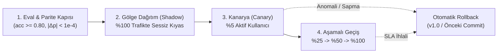

# SE Primer (`HBYS.Web`) — Sürüm, Dağıtım ve Mimari Ödünleşim Belgesi (`RELEASE.md`)

> **Aktif Sürüm:** `v2.0.0` (6 Kasım 2026)  
> **Önceki Temel Çizgi (Baseline):** `v1.0.0` (`a215169` — Kural Tabanlı Deterministik Kalibrasyon)  
> **Metodolojik Çerçeve:** Sommerville (2016) *Software Engineering* Bl. 6 (Mimari Tasarım), Bl. 13 (Güvenlik), Bl. 17 (Dağıtık Sistemler), Bl. 25 (Konfigürasyon ve Yayın Yönetimi); Shankar vd. (2024) *3V: Velocity, Validation, Versioning*; Sculley vd. (2015) *ML Sistemlerinde Gizli Teknik Borç*.

---

## 1. `v2.0.0` Sürümünde Ne Değişti? (`v1.0` → `v2.0`)

| Boyut | `v1.0.0` (Geçen Hafta — Kural Tabanlı) | `v2.0.0` (Bu Hafta — Davranışsal ONNX Modeli) |
| :--- | :--- | :--- |
| **Uyarlama Mekanizması** | Yalnızca girişteki 3 soruya (*Seviye × Rol × Hedef*) dayalı sabit `if/else` kuralları. | Sahne içi gerçek zamanlı davranış telemetrisinden (`karar_suresi_sn`, `tereddut_sayisi`, `log_inceleme_orani`, `onceki_riskli_karar`, `tutor_etkilesim_sayisi`, `kalan_sure_orani`) öğrenen `StandardScaler → LogisticRegression` ONNX modeli (`593 bayt`). |
| **Oyun Davranışı Değişimi** | `"Deneyimliyim"` seçen oyuncuya her zaman 60 sn sert sayaç uygulanır ve ipucu gizlenir; oyuncu paniklese bile sistem tepki vermez. | Model $p(\text{mudahale\_gerekli}=1) \ge 0.50$ ürettiğinde oyun dinamik olarak **Esnek Kriz Moduna (`+30 sn Bilişsel Tampon`)** geçer, **Proaktif Sokratik İpucu** ve **Karar Öncesi Etki Önizlemesi** kartlarını otomatik açar. |
| **Artefakt Sözleşmesi** | Uygulama koduna gömülü TypeScript sabitleri. | Taşınabilir `model/model.onnx` + şema sözleşmesi `model/config.json` + `model/README.md` (Mitchell vd., 2019 Model Kartı). |
| **Doğrulama ve Parite** | Yalnızca karar yollarını kontrol eden Cypress E2E testleri. | Eğitim öncesi **Altın Standart Eval Kapısı** (`accuracy >= 0.80`, `auc >= 0.85`, `f1 >= 0.78`) + 3 tüketicide (Tarayıcı `onnxruntime-web`, Python Oracle `tests/parite.py`, Sunucu API `server/app.py`) $|\Delta p| < 10^{-4}$ **Diferansiyel Parite Testi**. |

---

## 2. Sürüm Sabitleme (Version Pinning) ve Hugging Face Hub Adresleri

Sommerville (2016, Bl. 25: *Konfigürasyon Yönetimi — Temel Çizgi / Baseline*) ve Shankar vd. (2024, *3V — Versioning*) uyarınca, üretimdeki tüketiciler modeli değişken `main` dalından **indirmez**. `main` dalına yeni bir model yüklendiğinde istemcilerin habersizce davranış değiştirmesini (*silent model drift*) önlemek için model URL'si doğrudan **değişmez (immutable) Git commit özetine (`revision`)** sabitlenmiştir:

- **Hugging Face Model Reposu:** `https://huggingface.co/Arda-ERDEM/se-primer-v2-onnx`
- **Sabitlenmiş (Commit-Pinned) Model URL'si:**
  ```text
  https://huggingface.co/Arda-ERDEM/se-primer-v2-onnx/resolve/v2.0.0-baseline/model.onnx
  https://huggingface.co/Arda-ERDEM/se-primer-v2-onnx/resolve/v2.0.0-baseline/config.json
  ```
  *(Not: `python train.py --push-hf` komutu çalıştırıldığında dönen 40 karakterli tam SHA-1 özeti `<commit_sha>` uygulama içindeki `src/services/onnxAdaptiveEngine.ts` ve `public/site.json` dosyalarında sabitlenir; ayrıca çevrimdışı/CI sürekliliği için aynı byte-birebir artefakt `/model/model.onnx` altında yerel önbellekte tutulur.)*

---

## 3. Geri Alma (Rollback) Planı

Canlı ortamda aşağıdaki **Acil Geri Alma Tetikleyicilerinden (Rollback Triggers)** herhangi biri gözlemlenirse `v2.0.0` sürümünden bir önceki kararlı sürüme (`v1.0.0` veya önceki model commit'ine) **30 saniye içinde** geri dönülür:
1. **Parite Sapması:** Tarayıcı (`onnxruntime-web`) ile Python Oracle arasındaki olasılık farkının $|\Delta p| \ge 10^{-4}$ olması.
2. **Çıkarım Gecikmesi (Latency SLA İhlali):** İstemci içi ONNX çıkarım süresinin `p95 > 50 ms` sınırını aşması.
3. **Pedagojik Regresyon:** Müdahale edilen oturumlarda `SON_A_IYI` (başarılı kriz çözümü) oranının `v1.0` temel çizgisinin `%10` altına düşmesi.

### Geri Alma Komutları (Tek Komutla Rollback)

1. **Seviye 1 — Model Sürümünü Önceki Commit'e Çekme (Sıfır Derleme / Config Rollback):**
   `public/site.json` içerisindeki `commit` alanı bir önceki kararlı SHA'ya çevrilir:
   ```bash
   # Önceki kararlı model commit'ine veya yerel kural motoruna tek komutla dönüş:
   git checkout HEAD~1 -- public/site.json model/ && npm run build
   ```
2. **Seviye 2 — Tam Kural Motoruna Dönüş (Kill-Switch / Fallback Rollback):**
   Uygulama URL'sine `?mode=v1-rules` parametresi eklendiğinde veya `VITE_ADAPTIVE_MODE=rule_fallback` ortam değişkeni verildiğinde, ONNX çıkarımı devre dışı bırakılarak `v1.0` deterministik kural motoruna kesintisiz (*graceful degradation*) geçiş yapılır.

---

## 4. Yeni Sürümü Güvenle Devreye Alma (Shadow → Canary → Progressive Rollout)

Yeni eğitilen bir model (`v2.1` vb.) Eval Kapısını (`train.py`) ve Diferansiyel Parite Testini (`tests/parite.py`) geçse dahi doğrudan kullanıcıların `%100`'üne açılmaz; dört aşamalı güvenli dağıtım boru hattı işletilir:



1. **Aşama 1 · Shadow Deployment (Gölge Dağıtım — 24 Saat):**
   - `v2.0` ONNX modeli tarayıcıda gerçek oyuncu telemetrisi üzerinde arka planda sessizce çalıştırılır ve ürettiği $p_{\text{shadow}}$ olasılığı telemetri günlüğüne yazılır.
   - Ancak oyuncunun gördüğü arayüzü (süre sayacı ve ipucu görünürlüğü) hâlâ mevcut üretim kuralı (`v1.0`) yönetir.
   - **Kabul Kriteri:** `v2.0` modelinin çalışma zamanı hatası `%0` olmalı ve `v1.0` kurallarıyla çeliştiği durumlar (ör. deneyimli seçip panikleyen oyuncular) pedagojik beklentiyle uyuşmalıdır.
2. **Aşama 2 · Canary Deployment (Kanarya Dağıtımı — %5 Trafik):**
   - Rastgele üretilen anonim `oturum` kimliğinin özet değerine göre (`parseInt(oturumId, 16) % 100 < 5`), oyuncuların yalnızca **`%5`'lik diliminde** `v2.0` modelinin kararları oyunun davranışını gerçekten değiştirir.
   - Kalan `%95` kontrol grubunda kalır. İki grup arasında oturum tamamlama oranı ve karar süreleri karşılaştırılır.
3. **Aşama 3 · Progressive Rollout (Aşamalı Geçiş — `%25 → %50 → %100`):**
   - Kanarya diliminde hata görülmezse trafik sırasıyla `%25`, `%50` ve `%100` seviyesine çıkarılır. Her kademe arasında en az 10 gerçek oturumluk doğrulama penceresi beklenir.

---

## 5. Mimari Dağıtım Kararı ve Ödünleşim (Trade-off / Feragat) Matrisi

Ian Sommerville (*Software Engineering*, Bl. 6 & Bl. 17: *İstemci-Sunucu Görev Dağılımı*) ve Vijay Janapa Reddi (*Machine Learning Systems*, 2025) çerçevesinde, aynı `model.onnx` (`593 bayt`) artefaktını çalıştıran üç farklı mimari seçeneğin dersteki **3 temel soruya** göre ödünleşim analizi aşağıdadır:

| Değerlendirme Sorusu / Ölçüt | 1. Tarayıcı İçi Çıkarım (`onnxruntime-web` — **Birincil Mimari**) | 2. Cihaz İçi Mobil (`React Native / Expo` Gömülü ONNX) | 3. Kendi Sunucumuz (`FastAPI / Rails API` — **Bonus Mimari**) |
| :--- | :--- | :--- | :--- |
| **1. İnternet/ağ zorunlu mu ve gecikme (latency) nasıl davranır?** | **İlk indirmede ağ gerekir**, sonrasında model (`593 B`) ve WASM çalışma zamanı tarayıcı önbelleğine alınır. Sonraki her kararda ağ isteği sıfırdır; çıkarım gecikmesi **`< 1 ms`** düzeyindedir ve çevrimdışı çalışmaya devam eder. | Model uygulama paketine (`.apk`/bundle) **gömülü** ise **internet hiç gerekmez**; soğuk başlangıç dahil tamamen çevrimdışı ve **`< 1 ms`** deterministik gecikmeyle çalışır. Uzak model güncellemesi istenirse o zaman ağ gerekir. | **Her tahmin isteğinde ağ zorunludur.** İstemci ile sunucu arasındaki RTT (*Round-Trip Time*: `30–150 ms`) ve ücretsiz bulut katmanlarındaki (Render.com) **soğuk başlangıç (*cold start*: `15–30 sn`)** gecikmesi kullanıcı deneyimini doğrudan etkiler. |
| **2. Veri cihazdan çıkar mı? (6698 Sayılı KVKK ve Mahremiyet)** | **Hayır, veri cihazdan çıkmaz.** Oyuncunun karar süresi, el titremesi/tereddüt sayısı ve davranışsal telemetrisi tamamen kullanıcının kendi tarayıcı belleğinde işlenir. **KVKK açısından en güvenli (Privacy-by-Design) seçenektir.** | **Hayır, veri cihazdan çıkmaz.** Tüm davranışsal sensör ve etkileşim verisi telefonun işlemcisinde (CPU/NPU) kalır; üçüncü taraf sunucuya veri aktarımı (KVKK Madde 8/9) oluşmaz. | **Evet, veri cihazdan çıkar.** Her sahnede oyuncunun davranış vektörü HTTP `POST` gövdesinde sunucuya gönderilir. KVKK uyumu için şifreli kanal (`HTTPS/TLS`), IP maskeleme ve sunucuda kayıt tutmama (*stateless inference*) zorunludur. |
| **3. Model gizli kalır mı? (Fikri Mülkiyet vs. REA Riski)** | **Hayır, model açıktır.** Tarayıcı Ağ (Network) sekmesinden `model.onnx` ve `config.json` herkes tarafından indirilebilir; ağırlıklar (`coef_`) doğrudan okunabilir. | **Hayır, model gizli kalamaz.** Uygulama paketi (`.apk`) tersine mühendislikle (*decompile / unzip*) açıldığında gömülü `model.onnx` dosyası kolayca elde edilebilir. | **Evet, model dosyası gizli kalır.** `model.onnx` yalnızca sunucu diskinde/belleğinde durur. Ancak saldırgan çok sayıda sorgu gönderip olasılık yanıtlarını toplayarak **Model Çıkarma / Tersine Mühendislik (*Model Extraction / REA*)** saldırısı deneyebilir; bunu önlemek için *rate-limiting* ve çıktı yuvarlama gerekir. |
| **Ölçek Maliyeti & Sommerville Bl. 17 Sınıflandırması** | **Kalın İstemci (*Fat Client*):** Hesaplama maliyeti kullanıcının cihazındadır; 10.000 eşzamanlı oyuncuda dahi sunucu maliyeti **\$0**'dır. | **Kalın İstemci (*Fat Client*):** Hesaplama maliyeti tamamen mobil cihazdadır; sunucu ölçekleme derdi yoktur. | **İnce İstemci (*Thin Client*):** Hesaplama ve bellek maliyeti bizim sunucumuzdadır; trafik arttıkça CPU/RAM maliyeti doğrusal artar. |

### Karar Gerekçemiz (Neden Birincil Olarak `onnxruntime-web` + Bonus Olarak `Sunucu API` Seçildi?)
1. **Neden Tarayıcı (`onnxruntime-web`) Birincil Seçimdir?**
   `SE Primer v2.0` modelimiz ticari sır veya gerçek hasta verisi içeren bir model değil, `593 bayt` boyutunda pedagojik bir bilişsel yük sınıflandırıcısıdır. Buna karşılık oyuncunun davranışsal telemetrisinin (kararsızlık, bekleme süresi) cihazdan dışarı çıkmaması (**KVKK uyumu**) ve 60 saniyelik kriz sayacı akarken **sıfır ağ gecikmesiyle (`< 1 ms`)** anında tepki vermesi kritik önemdedir.
2. **Neden Sunucu Tüketicisi (`server/app.py`) Bonus Olarak Eklendi?**
   Eğer gelecekte model gerçek hastane personeli verisiyle eğitilirse ve model ağırlıklarının gizli tutulması (*IP protection*) gerekirse, aynı `model.onnx` + `config.json` sözleşmesinin hiçbir model kodu değiştirilmeden sunucu arkasında (`POST /api/v1/predictions`) $|\Delta p| < 10^{-4}$ pariteyle çalışabildiğini kanıtlamak için üçüncü tüketici olarak gerçeklenmiştir.
