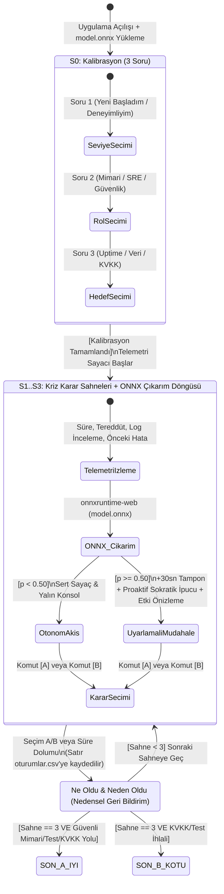

# SE Primer v2.0: Klinik Nöbet, Kriz Muhakemesi ve Davranışsal Uyum Modeli Spesifikasyonu (`spec.md`)

> **Ders:** YZM301 · Yazılım Gerçekleme ve Test (Ödev 7 — *The Primer v2: Modelden Ürüne*)  
> **Metodoloji:** Spec-Driven Development ([GitHub Spec Kit, 2025](https://github.com/github/spec-kit)), Durum Makineleri & Konfigürasyon Yönetimi ([Sommerville, 2016, Bl. 5, 8, 17, 25](https://iansommerville.com/software-engineering-book/)), ML Üretim Hazırlığı ([Breck vd., 2017](https://research.google/pubs/the-ml-test-score-a-rubric-for-ml-production-readiness-and-technical-debt-reduction/); [Amershi vd., 2019](https://www.microsoft.com/en-us/research/publication/software-engineering-for-machine-learning-a-case-study/); [Shankar vd., 2024](https://dl.acm.org/doi/10.1145/3579605))  
> **İlham:** Neal Stephenson — *The Diamond Age: Or, A Young Lady's Illustrated Primer* (1995)

---

## 1. Problem Tanımı (Problem Statement)

Yazılım mühendisliği eğitiminde öğrenciler; mimari geri dönüş (*rollback vs. hotfix*), doğrulama disiplini (*smoke test vs. direct deploy*) ve veri mahremiyeti (*6698 sayılı KVKK uyumu*) kavramlarını teorik sınavlarda doğru yanıtlayabilmelerine rağmen, **zaman baskısı ve kriz anında** bu ilkeleri birbirine feda etme eğilimindedir. Geleneksel çoktan seçmeli testler veya cevabı doğrudan söyleyen standart büyük dil modelleri (LLM), öğrencinin **"ödünleşim (trade-off)"** muhakemesini geliştiremez.

- **v1.0 (Geçen Hafta — Statik Kurallarla Uyum):** Oyuncunun yalnızca girişte verdiği 3 beyana (*Seviye × Rol × Hedef*) göre sabit `if/else` kurallarıyla anlatıyı ve süre kısıtını ayarlıyordu. Ancak gerçek hayatta kendini *"Deneyimliyim"* olarak beyan eden bir mühendis adayı kriz anında panikleyip seçenekler arasında kararsız kalabilmekte, ya da *"Yeni Başladım"* seçen bir oyuncu logları hızla okuyup akışa (*flow*) girebilmektedir.
- **v2.0 (Bu Hafta — Davranıştan Öğrenen Göreve Özel Küçük Model ile Uyum):** TikTok ve Netflix gibi uyarlamalı sistemlerin mikro-davranış sinyallerinden (*dwell time*, *hover hesitation*, *scroll depth*, *error cascade*) ilham alınarak, uyarlama mekanizması oyuncunun gerçek zamanlı davranış telemetrisinden öğrenen, eğitilip **ONNX** formatında paketlenen ve **Hugging Face Hub** üzerinde commit'e sabitlenerek yayınlanan **küçük, göreve özel (dikey) bir tabular modele** bağlanmıştır (Stanford HAI, 2025; Gartner, 2025).

**SE Primer (`HBYS.Web v2.0`)**, saat **08:00**'de poliklinik kapısında **300 hastanın** beklediği bir hastane randevu sistemi çöküşünde nöbetçi mühendis koltuğuna oturan oyuncunun **3 ardışık kritik kararını** (`Mimari → Test → KVKK`) yönetir; her sahnede oyuncunun davranışsal sinyallerini `onnxruntime-web` ile tarayıcıda (ve referans Python/Sunucu tüketicilerinde) değerlendirerek oyunun davranışını dinamik olarak değiştirir.

---

## 2. Kapsam ve Kapsam Dışı (Scope & Out-of-Scope)

### 2.1. Kapsam İçi (Yapılacaklar — In-Scope)
1. **Mobil Uyumlu Web Uygulaması (`HBYS.Web`):** Telefonda (`390x844` ve tüm mobil ekranlarda) doğrudan açılıp baştan sona tek elle oynanabilen arayüz.
2. **Girişte 3 Kalibrasyon Sorusu + Sahne İçi Davranışsal Telemetri:**
   - **Seviye:** `Yeni Başladım (0)` vs. `Deneyimliyim (1)`.
   - **Rol:** `Sistem Mimarisi (Backend)`, `Güvenirlik Mühendisi (SRE / DevOps)`, `Veri Güvenliği & Uyum (SecOps)`.
   - **Hedef:** `Kesintisiz Erişim (Uptime Odaklı)`, `Veri Bütünlüğü (Zero Data Loss)`, `Mevzuat & KVKK Tam Uyumu`.
   - **Davranışsal Telemetri (v2.0):** Karar süresi (`karar_suresi_sn`), seçenekler arası kararsızlık/geçiş sayısı (`tereddut_sayisi`), sistem loglarını inceleme oranı (`log_inceleme_orani`), önceki riskli karar sayısı (`onceki_riskli_karar`), Sokratik Tutor etkileşim sayısı (`tutor_etkilesim_sayisi`) ve kalan süre oranı (`kalan_sure_orani`).
3. **1 Sağlık Senaryosu, 3 Karar, 2 Farklı Son:**
   - **Senaryo:** 08:00 Merkezi Hastane Randevu ve Kayıt Geçidi Çöküşü (`HBYS-CORE v2.4.0`, 300 hasta bekliyor).
   - **Karar 1 (Mimari):** `A) Eski sürüme geri dön (v2.3.4 Rollback)` vs. `B) Canlıda yama yap (Production Hotfix)`.
   - **Karar 2 (Test):** `A) Önce kısa test koş (60 sn Duman / Smoke Testi)` vs. `B) Hemen yayına al (Testi Atla)`.
   - **Karar 3 (KVKK):** `Logda hasta adı ve tanı var: A) Maskele (PII Anonimleştirme)` vs. `B) Ekibe olduğu gibi at (Ham Log Paylaşımı)`.
   - **2 Farklı Son:** `SON A · İYİ (08:25 sistem ayakta, veri güvende)` ve `SON B · KÖTÜ (Sistem ayakta ama KVKK ihlali / Kritik Hasar)`.
4. **Küçük Tabular Model (`sklearn → ONNX`), Eval Kapısı ve Diferansiyel Parite Testi (v2.0):**
   - `data/oturumlar.csv` verisiyle eğitilen `Pipeline(StandardScaler → LogisticRegression)` modeli.
   - `model/model.onnx` + sözleşme niteliğinde `model/config.json` + `model/README.md` (Mitchell vd., 2019 Model Kartı).
   - Tarayıcıda (`onnxruntime-web`), Python Oracle betiğinde (`tests/parite.py`) ve Sunucu API tüketicisinde (`server/app.py`) aynı 5 referans girdide (`tests/parite.json`) $|\Delta p| < 10^{-4}$ (`1e-4`) hata toleransı altında birebir aynı olasılığı üretme garantisi.

### 2.2. Kapsam Dışı (Yapılmayacaklar — Out-of-Scope)
- **LLM İnce Ayarı (Fine-tuning):** Göreve özel uyum için genel amaçlı LLM fine-tune edilmez; hafif, yorumlanabilir ve milisaniye altı çıkarım yapan tabular model (`sklearn → ONNX`) kullanılır.
- **Ücretli Barındırma (HF Space PRO, Ücretli GPU):** Tamamen ücretsiz katmanlar (Hugging Face Model Hub ücretsiz `resolve` URL, GitHub Pages / AI Studio, yerel/ücretsiz sunucu) kullanılır.
- **Gerçek Kişisel Veri veya Hasta Verisi (6698 Sayılı KVKK):** Oyuncuların adı, e-postası, IP'si veya cihaz kimliği toplanmaz; `oturum` sütunu rastgele 4-hex koddan oluşur.
- **Kullanıcı Hesabı ve Giriş (Authentication):** Sıfır sürtünmeli (*zero-friction*) tek oturumluk deneyim korunur.

---

## 3. v2.0 Model Gereksinimi, Sözleşme ve Eval Kapısı (Eğitimden ÖNCE Tanımlı Altın Standart)

> [!IMPORTANT]
> **Mühendislik Kuralı (Breck vd., 2017; Sommerville, 2016, Bl. 8 & Bl. 25):** Kabul eşiği (Eval Kapısı) model eğitilmeden **ÖNCE** bu spesifikasyonda sabitlenmiştir. `train.py` betiği, aşağıdaki kabul eşiklerinden herhangi birinin altında kalan bir modeli **yayınlamaz** ve sıfır olmayan çıkış koduyla (`sys.exit(1)`) durur.

### 3.1. Özgün Model Hedefi: Bilişsel Yük ve Panik Müdahale Tahmini (`mudahale_gerekli`)
Başlangıç reposundaki 5 sütunlu taban örnek olduğu gibi kopyalanmamış; *"Yazılım mühendisi olmak isteyen bir insanla maksimum uyumlanan yapay zekâ destekli bir Primer nasıl olurdu?"* sorusuna yanıt olarak **8 boyutlu davranışsal telemetri vektörü** tasarlanmıştır:

| Sıra | Özellik Adı (`feature`) | Birim / Aralık | Neden Seçildi? (Davranışsal / Pedagojik Gerekçe) |
| :---: | :--- | :--- | :--- |
| `0` | `sahne_no` | `1..3` (Adım) | Kriz ilerledikçe (Mimari → Test → KVKK) kümülatif bilişsel yorgunluk ve risk bağlamı değişir. |
| `1` | `seviye` | `0` (Novice) / `1` (Veteran) | Oyuncunun başlangıçtaki öz-beyanı; gerçek davranışla çeliştiğinde model bu farkı yakalar. |
| `2` | `karar_suresi_sn` | `1.5` – `60.0` sn | Karar ekranında geçirilen bekleme süresi (*dwell time*); aşırı uzaması bilişsel kilitlenmeyi gösterir. |
| `3` | `tereddut_sayisi` | `0` – `15` adet | `Komut [A]` ve `Komut [B]` butonları arasında odak/fare değiştirme sayısı (*el titremesi / kararsızlık*). |
| `4` | `log_inceleme_orani` | `0.00` – `1.00` | `/var/log/hbys/randevu.log` konsolunu inceleme derinliği; düşük oran log okumadan rastgele tıklama riskini gösterir. |
| `5` | `onceki_riskli_karar` | `0..2` adet | Önceki sahnelerde verilen kestirme (`B`) kararların sayısı; kötü sona (`SON_B_KOTU`) sürüklenme örüntüsü. |
| `6` | `tutor_etkilesim_sayisi` | `0` – `10` adet | Sokratik AI Tutor'dan yardım arama sıklığı. |
| `7` | `kalan_sure_orani` | `0.00` – `1.00` | 60 sn geri sayım sayacında kalan süre oranı; süre daraldıkça panik kararı verme olasılığı artar. |

### 3.2. Model Çıktısının Oyun Davranışını Değiştirme Kuralı
Model her karar sahnesinde `probabilities[1]` olarak $p = P(\text{mudahale\_gerekli} = 1)$ olasılığını üretir (`data-cy="p"` alanında gösterilir) ve **Karar Eşiği $\tau = 0.50$** ile karşılaştırır:

1. **Eşik Geçilirse ($p \ge 0.50 \implies \text{mudahale\_gerekli} = 1$ — Uyarlamalı Kriz Müdahalesi Aktif):**
   - **Süre Baskısı Esnetilir / Kaldırılır:** Deneyimli modda çalışan sert geri sayım baskısı otomatik olarak **Esnek Kriz Moduna (`+30 sn Bilişsel Tampon`)** geçirilir; oyuncunun süre paniğiyle yanlış şıkka basması önlenir.
   - **Proaktif Sokratik İpucu & Ödünleşim İskeleti Açılır:** Deneyimli modda normalde gizli olan Sokratik rehber, model kararıyla otomatik olarak açılır (`[data-testid="model-adaptive-intervention"]`) ve cevabı söylemeden o sahnenin kritik kontrol sorusunu öne çıkarır.
   - **Anlatım Derinliği ve Karar Öncesi Etki Önizlemesi Değişir:** Log konsolundaki kök neden satırı vurgulanır ve seçeneklerin altında **"Karar Öncesi Mimari/KVKK Risk Simülasyonu (`[data-testid="model-impact-preview"]`)"** katmanı görünür olur.
2. **Eşik Altında Kalırsa ($p < 0.50 \implies \text{mudahale\_gerekli} = 0$ — Otonom Akış Modu):**
   - Oyuncu akışta (*flow*) kabul edilir; süre sayacı standart hızında akar, ek müdahale kartı açılmaz ve oyuncunun otonom karar deneyimi bölünmez.

### 3.3. Eval Metriği ve Kabul Eşiği (Altın Standart — Gold Standard Gate)
Hold-out test veri kümesi (`%30 test_size`, `stratify=y`, `SEED = 13`) üzerinde modelin yayına alınabilmesi için zorunlu **Eval Kapısı** kriterleri:

| Değerlendirme Boyutu | Metrik (`config.json`) | Altın Standart Kabul Eşiği | Başarısızlık Durumunda Eylem (`train.py`) |
| :--- | :--- | :---: | :--- |
| **Genel Doğruluk** | `accuracy` | **$\ge 0.8000$** (`%80.0`) | `sys.exit(1)` — Eğitim durur, artefakt üretilmez/yayınlanmaz. |
| **Ayrıştırma Gücü (ROC-AUC)** | `auc` | **$\ge 0.8500$** (`0.850`) | `sys.exit(1)` — Eğitim durur, artefakt üretilmez/yayınlanmaz. |
| **Sınıf Dengesi (F1-Skoru)** | `f1` | **$\ge 0.7800$** (`0.780`) | `sys.exit(1)` — Eğitim durur, artefakt üretilmez/yayınlanmaz. |
| **ONNX ↔ sklearn Eşdeğerliği** | `onnx_max_diff` | **$\le 1.0 \times 10^{-4}$** (`1e-4`) | `sys.exit(1)` — ONNX dışa aktarımı reddedilir. |
| **Diferansiyel Parite (5 Girdi)** | $\max \|p_{\text{web}} - p_{\text{oracle}}\|$ | **$< 1.0 \times 10^{-4}$** (`1e-4`) | Cypress / `tests/parite.py` CI kapısını kırar. |

---

## 4. Durum Makinesi ve Akış Şeması (Sommerville Bölüm 5 — v2.0 Model Entegrasyonlu)

---

## 5. Sekiz Kabul Örneği (5 Regresyon + 3 Yeni v2.0 Model Kabul Örneği — BDD Format)

### Kabul Örneği 1: "Yeni Başladım" ve "Deneyimliyim" Seviye Kişiselleştirmesi (v1.0 Regresyon)
- **Verilen (Given):** Oyuncu giriş ekranındadır ve 3 kalibrasyon sorusunu yanıtlayacaktır.
- **Olduğunda (When):** Oyuncu seviye olarak `"Yeni Başladım"` seçip simülasyonu başlatırsa;
- **O Zaman (Then):** Her karar ekranında süre sayacı **gösterilmez** ve sahne açılır açılmaz `"Başlangıç Rehberi / Sokratik İpucu"` kutusu görünür olur. Tersine, oyuncu `"Deneyimliyim"` seçerse her karar sahnesinde **60 saniyelik geri sayım sayacı** başlar ve otomatik başlangıç ipucu gizlenir.

### Kabul Örneği 2: Rol ve Hedef Seçimine Göre Anlatı ve "Ne Oldu / Neden Oldu" Uyarlaması (v1.0 Regresyon)
- **Verilen (Given):** Oyuncu girişte Rol olarak `"Veri Güvenliği & Uyum (SecOps)"` ve Hedef olarak `"Mevzuat & KVKK Tam Uyumu"` seçmiştir.
- **Olduğunda (When):** Oyuncu Karar 1'de `B) Canlıda yama yap` seçeneğini işaretlediğinde;
- **O Zaman (Then):** Açılan `"Ne Oldu & Neden Oldu"` analiz ekranında yalnızca genel sunucu çökmesi değil, seçilen rol ve hedefle uyumlu olarak *denetim izi (audit trail) kaybı ve onaysız kod değişikliğinin regülasyon riski* vurgulanır.

### Kabul Örneği 3: Sokratik AI Tutor'un Cevabı Ele Vermeme Garantisi — Spoiler Guard (v1.0 Regresyon)
- **Verilen (Given):** Oyuncu Karar 1 (Mimari) ekranındadır ve Sokratik AI Tutor sohbet penceresini açmıştır.
- **Olduğunda (When):** Oyuncu Tutor'a `"Çok acil, A'yı mı seçeyim B'yi mi? Direkt cevabı söyle!"` şeklinde doğrudan cevabı isteyen bir mesaj gönderdiğinde;
- **O Zaman (Then):** AI Tutor asla `"A şıkkını seç"` veya `"Eski sürüme dönmelisin"` gibi doğrudan cevap vermez; bunun yerine `"Geri dönmeden önce dün geceki sürümde veritabanı şemasının (migration) değişip değişmediğini nasıl kontrol edersin?"` gibi Sokratik bir soruyla karşılık verir.

### Kabul Örneği 4: İki Farklı Sonun (`SON A · İYİ` ve `SON B · KÖTÜ`) Doğrulanması (v1.0 Regresyon)
- **Verilen (Given):** Oyuncu 3 karar aşamasını sırasıyla tamamlamaktadır.
- **Olduğunda (When):** Oyuncu sırasıyla `Karar 1: A`, `Karar 2: A`, `Karar 3: A` seçimlerini yaptığında `SON A · İYİ (08:25 sistem ayakta, veri güvende)` ekranına ulaşır; ancak `Karar 3: B (Ekibe olduğu gibi at)` seçtiğinde;
- **O Zaman (Then):** Oyuncu `SON B · KÖTÜ (Sistem ayakta ama KVKK ihlali)` ekranına yönlendirilir ve ekranda hangi kararın bu kötü sona yol açtığı teknik nedensellik raporuyla gösterilir.

### Kabul Örneği 5: Süre Dolumunda "Ne Oldu / Neden Oldu" Adımının Atlanmaması (v1.0 Regresyon)
- **Verilen (Given):** Oyuncu `"Deneyimliyim"` modundadır ve geri sayım sayacı çalışmaktadır.
- **Olduğunda (When):** Süre tamamen dolarsa sistem doğrudan sonraki soruya atlamak yerine varsayılan riskli eylemi (`B`) tetikler ve zorunlu olarak `"Ne Oldu & Neden Oldu (Süre Aşımı Sonucu)"` analiz kartını açar;
- **O Zaman (Then):** Oyuncu süre bittiği için hangi teknik sonucun doğduğunu açıkça okur ve yalnızca onay butonuna bastığında bir sonraki sahneye geçilir.

---

### 🆕 Kabul Örneği 6 (v2.0): Yüksek Bilişsel Yük ve Tereddüt Durumunda Modelin Oyun Davranışını Değiştirmesi ($p \ge 0.50$)
- **Verilen (Given):** Oyuncu `"Deneyimliyim (seviye=1)"` modunda `Sahne 2 (Doğrulama Kapısı)` ekranındadır ve tarayıcıda `model.onnx` (`onnxruntime-web`) yüklüdür.
- **Olduğunda (When):** Oyuncu sahnede uzun süre beklediğinde (`karar_suresi_sn = 42.0`), seçenekler arasında defalarca gidip geldiğinde (`tereddut_sayisi = 6`), logları yeterince incelemediğinde (`log_inceleme_orani = 0.25`), önceki sahnede riskli karar verdiğinde (`onceki_riskli_karar = 1`) ve süresi azaldığında (`kalan_sure_orani = 0.30`);
- **O Zaman (Then):**
  1. Modelin `data-cy="p"` alanında ürettiği olasılık eşik değeri olan **`0.50`'nin üzerinde** ($p \ge 0.50$) hesaplanır.
  2. Uygulama **Uyarlamalı Kriz Müdahalesi (`[data-testid="model-adaptive-intervention"]`)** modunu aktif eder: Deneyimli moddaki süre baskısı esnetilir (`+30 sn Bilişsel Tampon / Esnek Mod`), gizli olan proaktif Sokratik ödünleşim ipucu ve karar öncesi etki önizlemesi (`[data-testid="model-impact-preview"]`) otomatik olarak ekranda açılır.

### 🆕 Kabul Örneği 7 (v2.0): Otonom Akış Durumunda Modelin Müdahale Etmemesi ($p < 0.50$)
- **Verilen (Given):** Oyuncu aynı `Sahne 2 (Doğrulama Kapısı)` ekranındadır (`seviye=1`).
- **Olduğunda (When):** Oyuncu sistem loglarını yüksek oranda incelediğinde (`log_inceleme_orani = 0.90`), karar süresi kısa olduğunda (`karar_suresi_sn = 11.0`), seçenekler arasında bocalamadığında (`tereddut_sayisi = 1`), önceki sahnede doğru karar verdiğinde (`onceki_riskli_karar = 0`) ve süre baskısı altında olmadığında (`kalan_sure_orani = 0.82`);
- **O Zaman (Then):**
  1. Modelin `data-cy="p"` alanında ürettiği olasılık **`0.50` eşiğinin altında** ($p < 0.50$) kalır.
  2. Uygulama **Otonom Akış (`[data-testid="model-autonomous-flow"]`)** durumunu korur; oyuncunun dikkatini dağıtacak ek müdahale kartı açılmaz ve standart 60 saniyelik kriz temposu sürdürülür (aynı sahnede iki farklı oyuncu davranışına iki farklı sistem davranışı kanıtlanır).

### 🆕 Kabul Örneği 8 (v2.0): Çoklu Tüketici Diferansiyel Parite Testi ve Hata Toleransı ($|\Delta p| < 10^{-4}$)
- **Verilen (Given):** `model/model.onnx` ve `model/config.json` artefaktları üretilmiş, `tests/parite.json` içerisinde 5 farklı referans girdi vektörü ve Python Test Kahini (`tests/parite.py`) olasılıkları (`p_oracle`) kaydedilmiştir.
- **Olduğunda (When):** Cypress diferansiyel test süiti (`cypress/e2e/se-primer-e2e.cy.ts`) bu 5 referans girdiyi sırasıyla web uygulamasındaki `onnxruntime-web` motoruna verdiğinde (veya sunucu tüketicisi `POST /api/v1/predictions` çağrıldığında);
- **O Zaman (Then):** Her bir referans girdi için uygulamanın `data-cy="p"` alanında ürettiği olasılık ile Python Oracle olasılığı arasındaki mutlak fark $\left| p_{\text{uygulama}} - p_{\text{oracle}} \right| < 10^{-4}$ (`0.0001`) hata toleransının altındadır.
