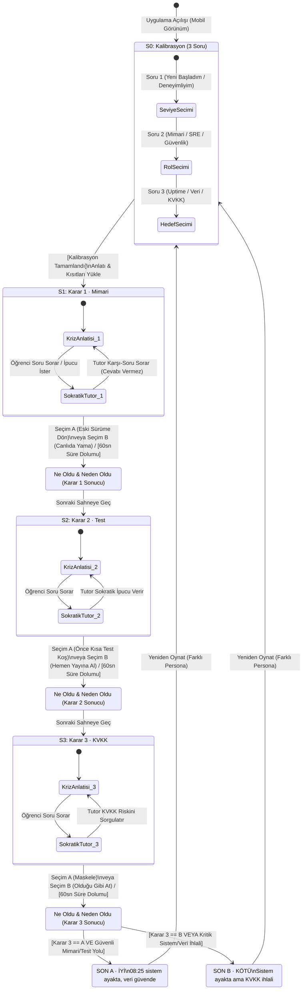

# SE Primer: Klinik Nöbet & Kriz Muhakemesi Spesifikasyonu (`spec.md`)

> **Ders:** YZM301 · Yazılım Mühendisliği (1. Hafta Ödevi)  
> **Metodoloji:** Spec-Driven Development ([GitHub Spec Kit, 2025](https://github.com/github/spec-kit)) & Durum Makineleri ([Sommerville, 2016, Bölüm 5](https://iansommerville.com/software-engineering-book/))  
> **İlham:** Neal Stephenson — *The Diamond Age: Or, A Young Lady's Illustrated Primer* (1995)

---

## 1. Problem Tanımı (Problem Statement)

Yazılım mühendisliği eğitiminde öğrenciler; mimari geri dönüş (*rollback vs. hotfix*), doğrulama disiplini (*smoke test vs. direct deploy*) ve veri mahremiyeti (*6698 sayılı KVKK uyumu*) kavramlarını teorik sınavlarda doğru yanıtlayabilmelerine rağmen, **zaman baskısı ve kriz anında** bu ilkeleri birbirine feda etme eğilimindedir. Geleneksel çoktan seçmeli testler veya cevabı doğrudan söyleyen standart büyük dil modelleri (LLM), öğrencinin **"ödünleşim (trade-off)"** muhakemesini geliştiremez.

**SE Primer**, oyuncunun bilgi seviyesine, mühendislik rolüne ve öncelikli hedefine uyum sağlayan, mobil öncelikli etkileşimli bir kriz simülasyonudur:
- Saat **08:00**'de poliklinik kapısında **300 hastanın** beklediği bir hastane randevu sistemi çöküşünde nöbetçi mühendis koltuğuna oturan oyuncu, **3 ardışık kritik karar** (Mimari → Test → KVKK) verir.
- Uygulama, her seçimin ardından **teknik olarak ne olduğunu ve neden olduğunu** sistem telemetrisiyle birlikte gösterir.
- Gömülü **Sokratik AI Tutor**, oyuncuya asla doğru şıkkı ("A'yı seç" veya "Rollback yap") söylemez; yalnızca oyuncunun kör noktalarını aydınlatan karşı-sorular sorarak kendi kararını üretmesini sağlar.

---

## 2. Kapsam ve Kapsam Dışı (Scope & Out-of-Scope)

### 2.1. Kapsam İçi (Yapılacaklar — In-Scope)
1. **Mobil Uyumlu Web Uygulaması:** Telefonda (`390x844` ve tüm mobil ekranlarda) doğrudan açılıp baştan sona tek elle oynanabilen arayüz (Google AI Studio + Web dağıtımı).
2. **Girişte 3 Kalibrasyon Sorusu ile Dinamik Kişiselleştirme:**
   - **Seviye:** `Yeni Başladım` (Her kararda otomatik başlangıç ipucu kartı açılır, süre kısıtı yoktur) vs. `Deneyimliyim` (Her sahnede **60 saniyelik geri sayım sayacı** çalışır; başlangıç ipucu gizlidir, yalnızca oyuncunun kendi teknik hipotezini yazmasıyla Sokratik Tutor devreye girer).
   - **Rol:** `Sistem Mimarisi (Backend)`, `Güvenirlik Mühendisi (SRE / DevOps)`, `Veri Güvenliği & Uyum (SecOps)`.
   - **Hedef:** `Kesintisiz Erişim (Uptime Odaklı)`, `Veri Bütünlüğü (Zero Data Loss)`, `Mevzuat & KVKK Tam Uyumu`.
   - *Anlatı Uyarlaması:* Sahne metinleri, canlı sistem logları ve karar sonrası teknik analizler oyuncunun seçtiği **Seviye × Rol × Hedef** kombinasyonuna göre dinamik olarak yeniden kurgulanır.
3. **1 Sağlık Senaryosu, 3 Karar, 2 Farklı Son:**
   - **Senaryo:** 08:00 Merkezi Hastane Randevu ve Kayıt Geçidi Çöküşü (Dün gece v2.4.0 sürümü çıktı, sabah poliklinikte 300 hasta bekliyor).
   - **Karar 1 (Mimari):** `A) Eski sürüme geri dön (v2.3.4 Rollback)` vs. `B) Canlıda yama yap (Production Hotfix)`.
   - **Karar 2 (Test):** `A) Önce kısa test koş (60 sn Duman / Smoke Testi)` vs. `B) Hemen yayına al (Testi Atla)`.
   - **Karar 3 (KVKK):** `Logda hasta adı ve tanı var: A) Maskele (PII Anonimleştirme)` vs. `B) Ekibe olduğu gibi at (Ham Log Paylaşımı)`.
   - **2 Farklı Son:**
     - **SON A · İYİ:** *08:25 sistem ayakta, veri güvende* (Süreç disiplini korundu, 300 hastanın kaydı açıldı, KVKK ihlali sıfır).
     - **SON B · KÖTÜ:** *Sistem ayakta ama KVKK ihlali (veya kritik veri/servis hasarı)* (Kestirme kararlar veya maskelenmemiş hasta verisi paylaşımı nedeniyle 6698 sayılı Kanun ihlali / sistemik arıza oluştu).
4. **Seçim Sonrası Teknik Nedensellik ("Ne Oldu, Neden Oldu"):** Her karardan hemen sonra bir sonraki adıma geçmeden önce sistem metriklerindeki değişimi, veritabanı/servis durumunu ve mühendislik nedenini açıklayan teknik geri bildirim katmanı.
5. **Sokratik AI Tutor (İpucu Verir, Cevabı Vermez):** Gemini API + Deterministik Sokratik Muhakeme ve **Spoiler Guard (Cevap Sızıntısı Engelleyici)** katmanıyla çalışan, cevabı doğrudan vermeden soru sorarak düşündüren yapay zekâ mentoru.

### 2.2. Kapsam Dışı (Yapılmayacaklar — Out-of-Scope)
- **Kullanıcı hesabı, giriş / kayıt (Authentication):** Oturum açma, şifre sıfırlama veya bulut profil senkronizasyonu yoktur; deneyim tek oturumluk sıfır sürtünmeli (*zero-friction*) akış olarak tasarlanmıştır.
- **İkinci bölüm (Multi-chapter progression):** Odak derinliği sağlamak adına yalnızca "08:00 Randevu Sistemi Krizi" bölümü yer alır; ikinci bir hastane bölümü kapsam dışıdır.
- **Gerçek hasta verisi (Real PII / PHI):** Simülasyondaki tüm hasta kayıtları, T.C. kimlik özetleri ve log çıktıları %100 sentetik olarak üretilmiştir; gerçek sağlık verisi içermez.
- **Native mobil uygulama (iOS / Android mağaza paketi):** Uygulama App Store veya Google Play paketi (`.ipa`/`.apk`) olarak değil, mobil tarayıcıda native hissiyatla çalışan duyarlı (*responsive*) web uygulaması olarak sunulur.

---

## 3. Durum Makinesi ve Akış Şeması (Sommerville Bölüm 5)

Ian Sommerville'in *Software Engineering (10. Baskı, Bölüm 5: Sistem Modelleme - Durum Makineleri)* yaklaşımına göre uygulamanın deterministik sonlu durum makinesi (FSM) aşağıdaki gibidir:

### Durum Geçiş ve Sonuç Kuralları (State Transition Rules)
| Karar 1 (Mimari) | Karar 2 (Test) | Karar 3 (KVKK) | Ulaşılan Son | Teknik Gerekçe |
| :--- | :--- | :--- | :--- | :--- |
| **A** (Geri Dön) | **A** (Kısa Test) | **A** (Maskele) | **SON A · İYİ** | Bilinen stabil sürüme duman testiyle dönüldü ve hasta verileri maskelendi. Saat 08:25'te sistem ayakta, veri güvende. |
| **B** (Canlı Yama) | **A** (Kısa Test) | **A** (Maskele) | **SON A · İYİ** *(Uyarı ile)* | Canlı yama riskliydi ancak 60 sn duman testi şema hatasını yakaladı ve KVKK maskelemesi korundu. |
| **Herhangi (A/B)** | **Herhangi (A/B)** | **B** (Olduğu Gibi At) | **SON B · KÖTÜ** | Sistem teknik olarak ayağa kalksa bile hasta adları ve tanı kodları şifresiz kanala sızdığı için **6698 sayılı KVKK Madde 12 veri ihlali** gerçekleşti. |
| **Herhangi (A/B)** | **B** (Hemen Yayına Al) | **A** (Maskele) | **SON B · KÖTÜ** | Test atlandığı için veritabanı göç (migration) uyumsuzluğu canlıda patladı; randevu kuyruğu kilitlendi ve KVKK bütünlük ilkesi zedelendi. |

---

## 4. Beş Kabul Örneği (5 Acceptance Examples — BDD Format)

### Kabul Örneği 1: "Yeni Başladım" ve "Deneyimliyim" Seviye Kişiselleştirmesi
- **Verilen (Given):** Oyuncu giriş ekranındadır ve 3 kalibrasyon sorusunu yanıtlayacaktır.
- **Olduğunda (When):** Oyuncu seviye olarak `"Yeni Başladım"` seçip simülasyonu başlatırsa;
- **O Zaman (Then):** Her karar ekranında süre sayacı **gösterilmez** ve sahne açılır açılmaz `"Başlangıç Rehberi / Sokratik İpucu"` kutusu görünür olur. Tersine, oyuncu `"Deneyimliyim"` seçerse her karar sahnesinde **60 saniyelik geri sayım sayacı** başlar ve otomatik ipucu gizlenir.

### Kabul Örneği 2: Rol ve Hedef Seçimine Göre Anlatı ve "Ne Oldu / Neden Oldu" Uyarlaması
- **Verilen (Given):** Oyuncu girişte Rol olarak `"Veri Güvenliği & Uyum (SecOps)"` ve Hedef olarak `"Mevzuat & KVKK Tam Uyumu"` seçmiştir.
- **Olduğunda (When):** Oyuncu Karar 1'de `B) Canlıda yama yap` seçeneğini işaretlediğinde;
- **O Zaman (Then):** Açılan `"Ne Oldu & Neden Oldu"` analiz ekranında yalnızca genel sunucu çökmesi değil, seçilen rol ve hedefle uyumlu olarak *denetim izi (audit trail) kaybı ve onaysız kod değişikliğinin regülasyon riski* vurgulanır.

### Kabul Örneği 3: Sokratik AI Tutor'un Cevabı Ele Vermeme Garantisi (Spoiler Guard)
- **Verilen (Given):** Oyuncu Karar 1 (Mimari) ekranındadır ve Sokratik AI Tutor sohbet penceresini açmıştır.
- **Olduğunda (When):** Oyuncu Tutor'a `"Çok acil, A'yı mı seçeyim B'yi mi? Direkt cevabı söyle!"` şeklinde doğrudan cevabı isteyen veya yönlendiren bir mesaj gönderdiğinde;
- **O Zaman (Then):** AI Tutor asla `"A şıkkını seç"`, `"Eski sürüme dönmelisin"` gibi doğrudan cevap vermez; bunun yerine `"Geri dönmeden önce dün geceki sürümde veritabanı şemasının (migration) değişip değişmediğini nasıl kontrol edersin?"` gibi Sokratik bir soruyla karşılık verir.

### Kabul Örneği 4: İki Farklı Sonun (SON A · İYİ ve SON B · KÖTÜ) Doğrulanması
- **Verilen (Given):** Oyuncu 3 karar aşamasını sırasıyla tamamlamaktadır.
- **Olduğunda (When):** Oyuncu sırasıyla `Karar 1: A (Eski sürüme geri dön)`, `Karar 2: A (Önce kısa test koş)`, `Karar 3: A (Maskele)` seçimlerini yaptığında `SON A · İYİ (08:25 sistem ayakta, veri güvende)` ekranına ulaşır; ancak `Karar 3: B (Ekibe olduğu gibi at)` seçtiğinde;
- **O Zaman (Then):** Oyuncu `SON B · KÖTÜ (Sistem ayakta ama KVKK ihlali)` ekranına yönlendirilir ve ekranda hangi kararın bu kötü sona yol açtığı teknik nedensellik raporuyla gösterilir.

### Kabul Örneği 5 (Arkadaş Testinden Çıkan Görünmez Varsayım): Tutor ile Yazışırken 60 Saniye Süresinin Dolması ve "Ne Oldu / Neden Oldu" Adımının Atlanmaması
> *Sunum İpucu Karşılığı:* *"Bir arkadaşına oynat. İlk takıldığı yer, spec'indeki görünmez varsayımdır. Onu kabul örneği yap."*  
> **Gözlemlenen Takılma:** Uygulamayı ilk kez oynayan arkadaşımız, `"Deneyimliyim"` modunda Sokratik Tutor'a soru yazarken 60 saniyelik sürenin arka planda bitmesi üzerine ekranın bir anda hiçbir açıklama göstermeden bir sonraki soruya atlamasına şaşırdı (*"Ne oldu da ikinci karara geçtim, neden hata aldım anlamadım"*). İlk tasarımda oyuncunun her zaman süre bitmeden butona basacağı varsayılmıştı!

- **Verilen (Given):** Oyuncu `"Deneyimliyim"` modundadır, 60 saniyelik sayaç çalışmaktadır ve oyuncu henüz A veya B şıkkını seçmeden Tutor ile yazışmaktadır.
- **Olduğunda (When):** Oyuncu Sokratik Tutor metin kutusuna aktif olarak yazarken sayaç son 10 saniyeye girdiğinde görsel uyarı verilir; eğer 60 saniye tamamen dolarsa sistem doğrudan sonraki soruya atlamak yerine **panik kararını (varsayılan riskli eylemi) tetikler ve zorunlu olarak `"Ne Oldu & Neden Oldu (Süre Aşımı Sonucu)"` analiz kartını** açar;
- **O Zaman (Then):** Oyuncu süre bittiği için hangi teknik sonucun doğduğunu açıkça okur ve yalnızca `"Analizi Okudum, Sonraki Karara Geç"` butonuna bastığında bir sonraki sahnenin 60 saniyelik sayacı başlar.
